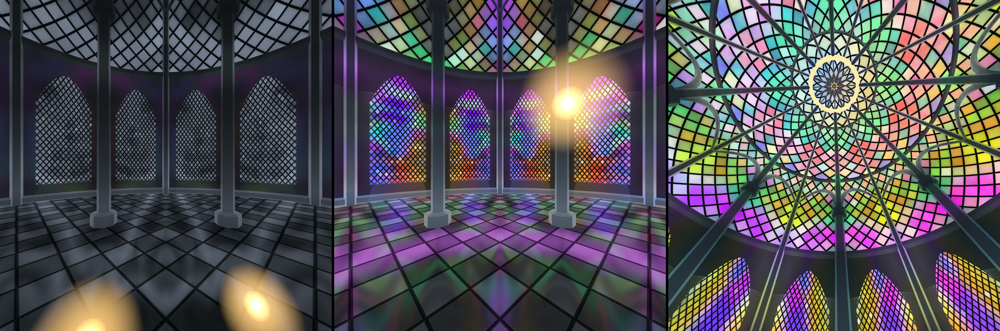
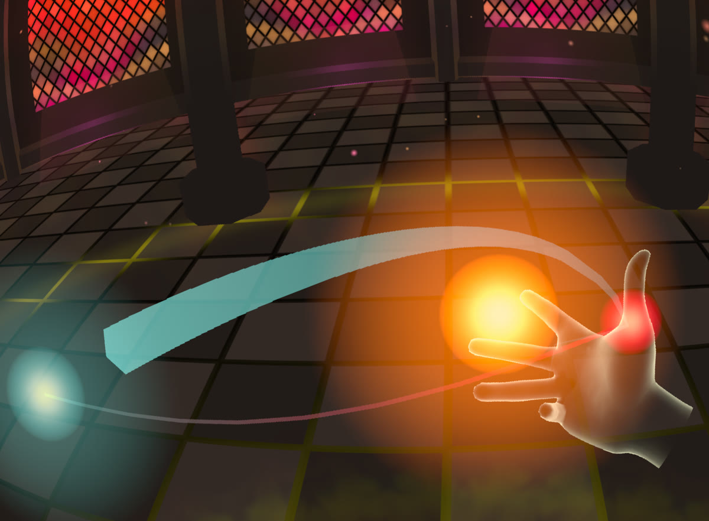

# Cathedral of Feedback



A Meta Quest 3 instrument you stand inside. A 20 m gothic vault of stained glass is lit by a
video-feedback loop that the music and your hands write into; two glowing orbs are the
instrument; everything you play comes back as echoes, in sound and in light.

Unity 6000.3.18f1, Meta XR Core SDK 205, OpenXR, Vulkan, built-in render pipeline. No imported
art: the building, the shaders and the music are all generated by code. The only audio files are
AutoJack's spoken tour and five one-shots (bell, choir, breaking glass, the harvest swirl, the catch).

## Playing it



| | Hands | Controllers |
|---|---|---|
| Take an orb | close your hand around it, or pinch it | grip or trigger |
| Pitch | raise / lower the orb (A minor pentatonic, two octaves, scaled to your height) | same |
| Brightness, 8ths to 16ths | move faster | same |
| Plant a note | hold the orb still for half a second (its halo draws in, then it buds a note), or let go gently | same |
| Throw | let go mid-swing: a comet of the orb's light flies off and the orb is back by your hand at once | same |
| Column rally | hit columns three times in quick succession and the whole ring answers | same |
| Supernova (the hidden one) | meet a returning comet with an orb that is already in your hand: the two collide, the room drops, the next eight bars run flat out an octave up, and every bell tied to that orb goes off in turn along its thread | same |
| Wake the cathedral | a struck column stays lit; light all eight and the vault blooms with gold light and the choir | same |
| Catch | a comet that strikes a column flies back and slows near you: meet it with a hand and the orb is in that hand, ready to throw again (close your hand to keep it). Three catches in a row wind the room up and drop it | same |
| Strum | throw a comet through hanging notes; three on one throw sets off a flourish | same |
| Pop a planted note | poke it; pop several quickly and the pops climb the scale | touch it |
| Harvest | clap with three or more notes hanging: they fly up into the lantern and the room drops | - |
| Orb clap | clap the two held orbs together without stretching the string first: a crash, a shockwave, and every hanging bell sounds at once | same |
| Whirl | keep an orb moving fast in circles for a couple of seconds: its trail closes into a ring, and six comets fly out of it | same |
| Walk | each floor tile you step onto lights up, rings a soft note and sends a ripple out | same |
| Build-up and drop | hold both orbs, stretch the string between them, bring them back together: the room drops and both orbs leave your hands, spiralling round each other up through the lantern and out of the building | same |
| Change room mode | poke the small prism at your left hip (or pinch thumb + middle finger) | touch the prism, or A / X |

**Three ways your playing comes back.** Echoes: ghost orbs replay your movement and notes one,
two, three and four bars later, each pass quieter, a canon with yourself. Planted notes: the room
has 16 bays and a bar has 16 steps; a light runs round the bays once per bar and every note you
have left in the air rings as a glass bell when the light reaches the bay behind it, so you build
a loop by placing sounds around yourself. Each note stays tied to the orb that made it by a thread
of light, and the orb flashes when its note rings. Light: everything is written into the feedback field
that the glass is made of.

Every drop (the string, a harvest, three catches) moves the whole piece to the next of four keys
(A, C, D and G minor) and the colour of the light moves with it, climbing the walls from the floor.

**The room sleeps until it is played.** A new wearer finds it dim and grey, the music a distant
heartbeat, and the two orbs the only colour. Taking one answers at once; holding, planting,
striking and catching bring the colour up, and any drop brings it all the way. With empty hands
it sinks back over half a minute, but never below what the hanging bells hold up: leave notes
around the room and it stays awake.

**Eight secrets.** Each column carries a gem at head height, a grey ember until its secret is
found: the string drop, the harvest, three catches in a row, the column rally, the bloom, the
supernova, the orb clap and the whirl. Light all eight and the cathedral plays its finale. They
go dark again for the next wearer.

Holding an orb builds the arrangement (drums, bass and hats come in); letting go lets it settle.
Raising an orb opens the filter on the beat. The eight columns are drums, tuned to the same scale.

Room modes, in order: **virtual**; **windows** (the real room, in stereo passthrough, is what
you see through the lancet glass); **open** (the walls dissolve into the real room).
The prism's colour shows the mode. `adb shell input keyevent KEYCODE_M` also steps it.

## How it works

- **`FeedbackField` + `Hidden/Cathedral/FeedbackStep`**: a 256x1024 ping-pong render target in
  kaleidoscope coordinates (u = azimuth inside one of 16 mirrored wedges, v = angle from the apex).
  Each frame the last frame rises, twists and echoes into itself at double frequency, then the
  live spectrum is written at the foot of the wall and touches are splatted in. The fractal depth
  comes from iterating across frames, so it costs one small blit regardless of eye resolution.
- **`Cathedral/Glass`**: the shell. Diamond panes each sample the field at their own centre, which
  turns a soft low-res light field into crisp stained glass for two texture fetches a pixel. Walls
  carry one lancet window per bay; the vault is glass rib to rib.
- **`Cathedral/Floor`**: checkerboard whose reflection is the field looked up along the mirrored
  view ray: per-eye correct, no reflection camera.
- **`Nave`**: the building as maths: shell, ribs, mouldings, and eight Gaudí-style columns that
  branch into the vault and carry a lantern ring. Meshes are generated at startup.
- **`CathedralDsp`**: the whole soundtrack as one sample-accurate C# synth (drums, bass, organ,
  arpeggio, ten orb/echo voices, reverb). Its sample clock is the beat clock for the visuals. It is
  voiced for headset speakers: under 3% of the mix's energy sits below 100 Hz.
- **`TrailEcho`**: records orb motion and notes against the beat clock and replays them through
  ghost orbs and echo voices.
- **`SeedGarden`**: planted notes. Each one is assigned the bay behind it as its step; the synth
  rings the pattern sample-accurately and the glass shader lights the bay that is sounding. Also
  the threads back to the orbs, pops and their combo, the clap harvest, and the spark bursts.
- **`CometPool`**: thrown light. The orbs never leave the player; a throw launches a pooled comet
  that is steered onto the nearest column, rings what it hits, ricochets off the shell and fades.
  A column strike sends it back to the player to be caught; a run of catches is a build-up.
- **`FloorLights`**: the lit tile under the player, step notes and floor ripples (feet are taken
  to be under the head; the headset has no foot tracking).
- **`OrbString`**: the string between two held orbs, the build-up it drives and the drop.
- **`ModePrism`**, **`ColumnDrum`**: touch target for room modes; the columns as tuned drums.
- **`Narrator`**: AutoJack's spoken tour. It waits for each gesture and confirms it, or nudges
  after a while; it restarts when the headset has been off for 20 s, so every wearer is welcomed.
  The music drops to a fifth of its level under his voice. The lines and the recorded effects are
  in `Assets/Audio` (ElevenLabs, high-passed for the headset speakers); everything else you hear
  is synthesised live.
- **`CathedralDirector`**: energy, room modes, floor calibration, performance settings, perf log.

## Building and checking

The scene is code. `Cathedral > Build Scene` regenerates `Assets/Scenes/Cathedral.unity` and its
materials from `Assets/Editor/CathedralBuilder.cs`; nothing in the scene is hand-edited.

```bash
scripts/build-quest.sh --install
```

builds in an isolated copy of the project (so the working tree stays editable), validates the APK,
installs it on the connected headset and launches it. It wakes the headset first: Horizon OS
keeps an app's audio muted for its whole lifetime if it is launched while the headset is asleep,
so the script also checks that the OS reports the app's audio player as unmuted. Watch it run with:

```bash
adb logcat -s Unity:V | grep Cathedral
```

Every five seconds the app logs frame rate, GPU time, synth output level, tracked hands, held
orbs, room mode and head pose. Measured on Quest 3: 90 Hz locked at 1.25x render scale, about
4.5 ms of GPU per frame.

```bash
/Applications/Unity/Hub/Editor/6000.3.18f1/Unity.app/Contents/MacOS/Unity -batchmode -quit -projectPath . -executeMethod CathedralPreview.Run -logFile Logs/preview.log
```

runs the real synth, analyser and feedback loop offline for a scripted 20 s performance (about
20 s wall clock) and writes stills, the raw field and `mix.wav` to `Previews/`, with loudness and
sub-100 Hz statistics in the log. It needs a graphics device, so do not add `-nographics`.
Set `CATHEDRAL_PREVIEW_WAKE=0` to render the room asleep, as a new wearer first sees it.

The picture at the top is three offline renders from the preview harness (the room asleep, awake,
and looking up); the one under *Playing it* is a capture from the headset.

## Licence

MIT; see [LICENSE](LICENSE). The Meta XR SDK packages it depends on carry their own licences. AutoJack's
spoken lines in `Assets/Audio` are generated from a cloned voice and are included for this project;
please do not reuse them to voice anything else.
